<p align="center">
<a href="https://emrecancioglu.com">
  <picture>
    <source media="(prefers-color-scheme: dark)" srcset="docs/readme/hero-dark.svg" />
    <source media="(prefers-color-scheme: light)" srcset="docs/readme/hero-light.svg" />
    
  </picture>
</a>
</p>

<p align="center">
  <a href="https://emrecancioglu.com"></a>
  <a href="https://github.com/emrecancioglu7/AWS-Cloud-Resume/actions/workflows/deploy-web.yml"></a>
  <a href="https://github.com/emrecancioglu7/AWS-Cloud-Resume/actions/workflows/ci-api.yml"></a>
  <a href="https://cloudresumechallenge.dev/"></a>
</p>

<p align="center">
  
  
  
  
  
  
  
  
  
</p>

My personal site, **[emrecancioglu.com](https://emrecancioglu.com)**. It started as my entry for **[#TheCloudResumeChallenge](https://cloudresumechallenge.dev/)**: a static resume on S3 with a serverless visitor counter. It has since grown into a full serverless app: a bilingual, prerendered resume site, plus a private admin panel that tracks my fund portfolio and uses AI to analyze credit card statements. All of it runs on AWS and is deployed from this repo.

## ✨ What's inside

<p align="center">
  <picture>
    <source media="(prefers-color-scheme: dark)" srcset="docs/readme/features-dark.svg" />
    <source media="(prefers-color-scheme: light)" srcset="docs/readme/features-light.svg" />
    
  </picture>
</p>

## 🏗 Architecture

<p align="center">
  <picture>
    <source media="(prefers-color-scheme: dark)" srcset="docs/readme/architecture-dark.svg" />
    <source media="(prefers-color-scheme: light)" srcset="docs/readme/architecture-light.svg" />
    
  </picture>
</p>

| Flow | How it works |
|---|---|
| 🌐 **Public site** | Route 53 + ACM certificate → CloudFront → S3. Pages are prerendered (English `/` and Turkish `/tr`), so crawlers and link previews get the full resume without running JavaScript. |
| 🔐 **Admin API** | Cognito login (SRP + TOTP MFA) → API Gateway HTTP API with a JWT authorizer → one Node 20 Lambda → a single DynamoDB table. |
| 🤖 **Statement analysis** | The browser uploads a PDF straight to S3 with a presigned URL. The S3 event triggers a processor Lambda, which gets its API key from SSM and asks OpenAI (structured outputs) for categorized transactions, then writes them to DynamoDB. |

## 🚀 Deploy pipeline

Every push to `main` runs [`deploy-web.yml`](.github/workflows/deploy-web.yml):

<p align="center">
  <picture>
    <source media="(prefers-color-scheme: dark)" srcset="docs/readme/pipeline-dark.svg" />
    <source media="(prefers-color-scheme: light)" srcset="docs/readme/pipeline-light.svg" />
    
  </picture>
</p>

The build fails if a prerendered page is broken: a wrong title, canonical or hreflang, invalid JSON-LD, or missing resume text. A broken page for crawlers therefore never ships. The backend (`apps/api` + `infra`) is deployed with `terraform apply`. [`ci-api.yml`](.github/workflows/ci-api.yml) typechecks, tests and builds it on every change.

## 📁 Repository layout

```
apps/web/   Vite + React 19 + TypeScript + Tailwind v4: public site and admin panel
apps/api/   Lambda backend (Node 20, TypeScript, esbuild): API + statement processor
infra/      Terraform: Cognito, DynamoDB, Lambda, API Gateway, S3, budget alarm
docs/readme/  Animated SVGs used in this README (generated)
```

## 🛠 Run it locally

```bash
cd apps/web && npm install && npm run dev      # site at http://localhost:5173
npm run test && npm run build                  # Vitest + production build with prerender checks
```

```bash
cd apps/api && npm install && npm run test && npm run build
```

<details>
<summary><b>🧗 How I built it: the Cloud Resume Challenge steps</b></summary>

<br/>

1. **Frontend:** wrote the resume in HTML/CSS/JS (now React), hosted it on **S3**, and put **CloudFront**, **Route 53** and an **ACM** certificate in front of it.
2. **Backend:** added a **Lambda** + **DynamoDB** visitor counter.
3. **API:** exposed it with **API Gateway**, so the database is never reachable directly from the internet.
4. **CI/CD:** set up **GitHub Actions** to sync the build to S3 and invalidate the CloudFront cache on every push.
5. **Infrastructure as Code:** moved the backend into **Terraform**, using a least-privilege IAM user.
6. **Beyond the challenge:** added Cognito auth with MFA, the portfolio admin panel, AI statement analysis, SSR prerendering with SEO checks, and an AWS Budgets cost alarm. Everything is designed to stay within the free tier.

> 💡 If you're starting out in the cloud, I highly recommend the [Cloud Resume Challenge](https://cloudresumechallenge.dev/). You learn far more by building it than by reading about it.

</details>

<p align="center">
  <picture>
    <source media="(prefers-color-scheme: dark)" srcset="docs/readme/footer-dark.svg" />
    <source media="(prefers-color-scheme: light)" srcset="docs/readme/footer-light.svg" />
    
  </picture>
</p>

<sub>README artwork is generated by <a href="scripts/build_readme_assets.py"><code>scripts/build_readme_assets.py</code></a>. To change the text, edit it there and run <code>python3 scripts/build_readme_assets.py</code>.</sub>
